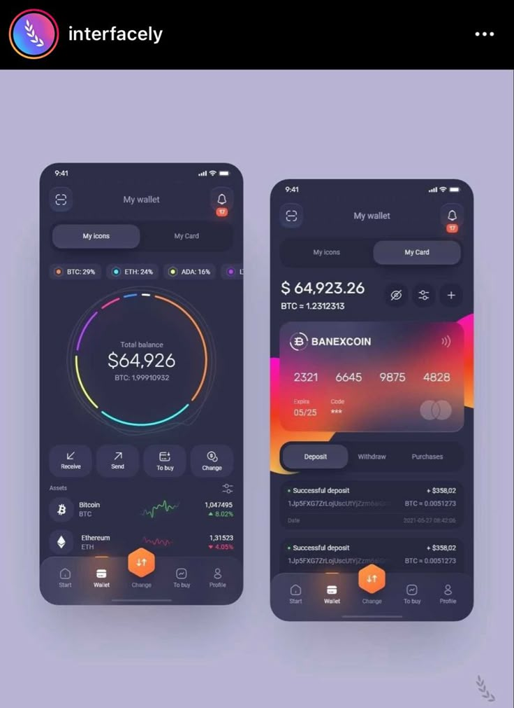
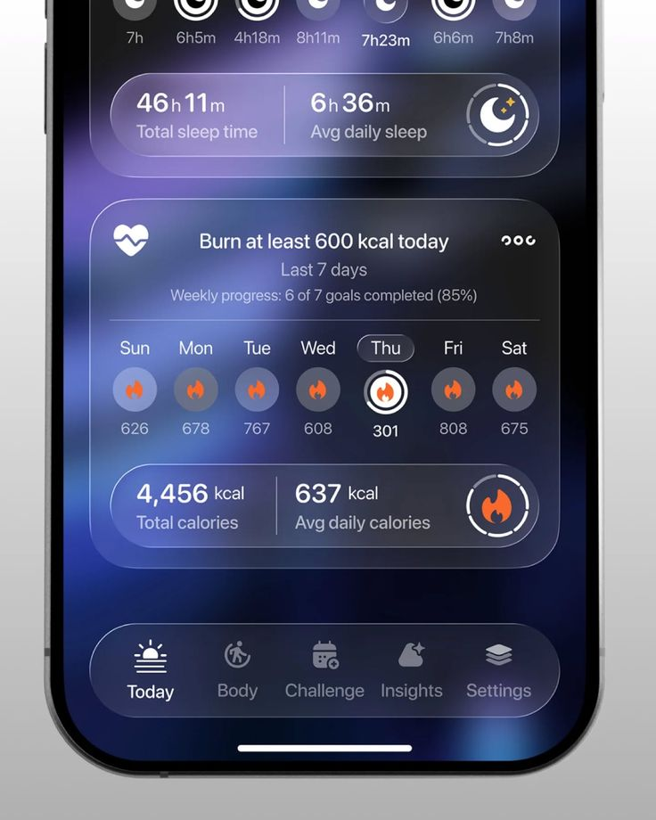
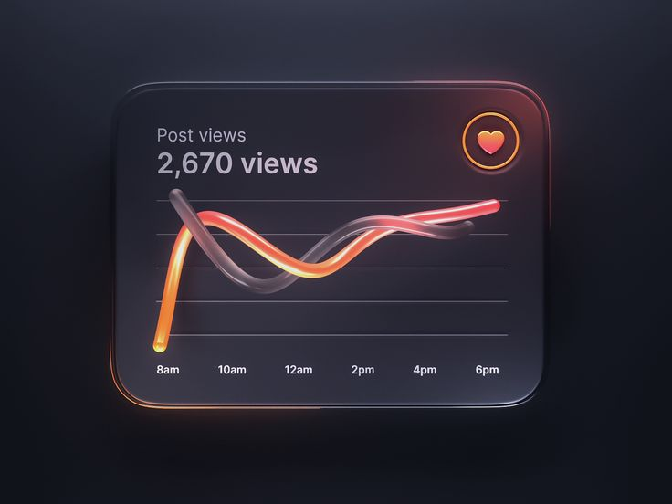

# FC Arena — Dark Glassmorphic Theme & Profile Theme Switcher

এই প্ল্যানের মাধ্যমে **FC Arena** অ্যাপে একটি প্রিমিয়াম **Dark Glassmorphic Theme (ডার্ক গ্লাস মোড)** এবং প্রোফাইল সেকশনের নিচে **Light / Dark Theme Switcher** যুক্ত করা হবে। অ্যাপটি প্রথমবার ওপেন করলে ডিফল্টভাবে বর্তমান **Light Theme** চালু থাকবে, এবং ব্যবহারকারী প্রোফাইল থেকে ডার্ক মোডে সুইচ করলে আপনার দেওয়া রেফারেন্স ছবির মতো ডিপ নেভি-ভায়োলেট (`#181928` / `#1E2032`) ব্যাকগ্রাউন্ড, ফ্রস্টেড গ্লাস কার্ড (`backdrop-blur`), রিম-লাইট বর্ডার এবং অরেঞ্জ-সায়ান-পার্পল অ্যাম্বিয়েন্ট গ্লো ইফেক্ট পুরো অ্যাপে প্রযোজ্য হবে।

## User Review & Critical Decisions

> [!IMPORTANT]
> নিচের সিদ্ধান্তগুলো আপনার উত্তরের ভিত্তিতে চূড়ান্ত করা হয়েছে এবং এর নিচেই ভিজ্যুয়াল ডেমো প্রিভিউ যুক্ত করা হয়েছে:

- **Confirmed Decision 1 — Default Theme Posture**: অ্যাপটি প্রথমবার লোড হলে ডিফল্টভাবে বর্তমান **Light Theme** চালু থাকবে।
- **Confirmed Decision 2 — Dark Glass Palette & Glow**: একেবারে পিচ-ব্ল্যাক (`#000000`) ব্যবহার না করে ছবির মতো **Deep Navy-Violet (`#181928` থেকে `#222437`)** ক্যানভাস এবং কার্ডের পেছনে ও বর্ডারে **Orange (`#FF7A45`), Cyan (`#38BDF8`), ও Purple (`#A855F7`)** অ্যাম্বিয়েন্ট গ্লো ও গ্লাস ইফেক্ট ব্যবহার করা হবে।
- **Confirmed Decision 3 — Dual Persistence**: ব্যবহারকারী প্রোফাইল থেকে থিম পরিবর্তন করলে সেটি সাথে সাথে **Device Local Storage** এবং লগইন করা **User Account Profile (`themePreference`)**—দুই জায়গাতেই সেভ হবে।

---

## 1. Overview & Core Concept

- **What It Does**: পুরো অ্যাপ্লিকেশনে (Dashboard, Arena Tournaments, Knockout Brackets, Match Cards, My Match, Modals, Header ও Bottom Navigation) একটি প্রফেশনাল **Frosted Glass Dark Mode** যুক্ত করে এবং প্রোফাইল পেজের নিচে একটি ওয়ান-ট্যাপ **Appearance / Theme Switcher** প্রদান করে।
- **Target Audience / Persona**: টুর্নামেন্টের প্লেয়ার, পাবলিশার এবং অ্যাডমিন—যারা রাতের বেলা বা দীর্ঘ সময় টুর্নামেন্ট ব্রাউজ করার সময় চোখের আরামদায়ক ও আধুনিক গ্লাসমরফিক ডার্ক ইন্টারফেস পছন্দ করেন।
- **Key Value**: এক ক্লিকেই লাইট ও ডার্ক গ্লাস থিমের মধ্যে তাৎক্ষণিক পরিবর্তন, ডিভাইস বদলালেও অ্যাকাউন্টে থিম সেভ থাকা, এবং প্রতিটি কার্ডে প্রিমিয়াম ৩ডি গ্লাস ও রিম-লাইটিং অভিজ্ঞতা।

---

## 2. User Experience & Visual Design (With Visual Demos)

### রেফারেন্স ইন্সপিরেশন ও কালার অ্যানাটমি (Reference Inspiration)

আপনার দেওয়া রেফারেন্স ছবিগুলোর মূল ইউআই বৈশিষ্ট্যগুলো নিচে দেওয়া হলো যা আমাদের অ্যাপের কার্ড ও নেভিগেশনে অনুসরণ করা হবে (ছবির কনটেন্ট নয়, শুধুমাত্র গ্লাস ও কালার ডিজাইন):





---

### Visual Identity & Theme Tokens

| ডিজাইন এলিমেন্ট (Design Element) | Light Mode (Default) | Dark Glass Mode (New) |
| :--- | :--- | :--- |
| **App Canvas (`--background`)** | Soft Alabaster (`#F0F1F5` / `#F8FAFC`) | Deep Navy-Violet (`#171826` → `#1E2034` radial gradient) |
| **Primary Glass Card (`nm-flat` / `Card`)** | Neumorphic Soft White (`#F0F0F3`) | Frosted Glass (`rgba(36, 39, 62, 0.68)`) + `backdrop-blur-2xl` |
| **Recessed / Inset Slot (`nm-inset`)** | Recessed Light Grey (`#E6E6E9`) | Deep Smoked Glass (`rgba(20, 22, 37, 0.78)`) + inner shadow |
| **Glass Border & Rim Light** | `1px solid rgba(255, 255, 255, 0.65)` | Top/Left specular highlight `rgba(255, 255, 255, 0.14)` + warm/cool rim glow |
| **Ambient Backlight Glows** | Subtle Indigo/Green soft tint | Warm Orange (`#FF6B35`), Electric Cyan (`#38BDF8`), Royal Violet (`#A855F7`) |
| **Primary Text** | Deep Slate (`#0F172A` / `#1E293B`) | Crisp Ice White (`#F8FAFC`) |
| **Secondary / Muted Text** | Cool Slate (`#64748B` / `#94A3B8`) | Lavender-Grey (`#94A3B8` / `#A5B4FC`) |

---

### ডেমো ১: ডার্ক গ্লাস ম্যাচ কার্ড ও টুর্নামেন্ট কার্ড (Dark Glass Match Card Demo)

রেফারেন্স ছবির ফ্রস্টেড কার্ড ও অরেঞ্জ-পার্পল গ্লো অনুসরণ করে আমাদের অ্যাপের **Match Card** এবং **2-Match Pair Container** ডার্ক মোডে যেমন দেখাবে:

```
┌──────────────────────────────────────────────────────────────────────────────┐
│  ✨ AMBIENT GLOW: Top-Left Orange (#FF7A45/20) · Bottom-Right Violet (#8B5CF6/20) │
│  ╭────────────────────────────────────────────────────────────────────────╮  │
│  │  PAIR #1 · 2 MATCHES                      🏆 AGGREGATE SCORE: 3 - 1   │  │
│  ├───────────────────────────────────┬────────────────────────────────────┤  │
│  │ 🟢 GROUP STAGE · GROUP A          │ 🟢 GROUP STAGE · GROUP A           │  │
│  │ [LEG 1 OF 2]          [RESULT]    │ [LEG 2 OF 2]           [RESULT]    │  │
│  │                                   │                                    │  │
│  │    HOME              AWAY         │    HOME               AWAY         │  │
│  │   ╭────╮            ╭────╮        │   ╭────╮             ╭────╮        │  │
│  │   │ 👤 │   2  -  1  │ 👤 │        │   │ 👤 │   0  -  1   │ 👤 │        │  │
│  │   ╰────╯            ╰────╯        │   ╰────╯             ╰────╯        │  │
│  │  ALFHA-W           GAMER-S        │  GAMER-S            ALFHA-W        │  │
│  │                                   │                                    │  │
│  │  ╭─────────────────────────────╮  │  ╭──────────────────────────────╮  │  │
│  │  │ 💬   ✅ RESULT CONFIRMED    │  │  │ 💬   ✅ RESULT CONFIRMED     │  │  │
│  │  ╰─────────────────────────────╯  │  ╰──────────────────────────────╯  │  │
│  ╰───────────────────────────────────┴────────────────────────────────────╯  │
│  Surface: rgba(34, 37, 58, 0.72) + backdrop-blur(24px)                       │
│  Border: 1px solid rgba(255,255,255,0.12) + subtle orange/cyan rim highlight │
└──────────────────────────────────────────────────────────────────────────────┘
```

---

### ডেমো ২: প্রোফাইল সেকশনের নিচে থিম সুইচ বাটন (Profile Theme Switcher Demo)

প্রোফাইল পেজের নিচে **GLOBAL ALERTS** সেকশনের ঠিক নিচে (ভার্সন ইনফোর উপরে) একটি নতুন **APPEARANCE / THEME MODE** গ্লাস কার্ড যুক্ত হবে, যেখান থেকে ব্যবহারকারী এক ক্লিকেই **LIGHT** অথবা **DARK GLASS** মোড সুইচ করতে পারবেন:

```
┌──────────────────────────────────────────────────────────────────────┐
│  GLOBAL ALERTS                                                       │
│  ╭────────────────────────────────────────────────────────────────╮  │
│  │  🔔  Notifications                                 [ ENABLE ]  │  │
│  │      Active                                                    │  │
│  ╰────────────────────────────────────────────────────────────────╯  │
│                                                                      │
│  APPEARANCE & THEME                                                  │
│  ╭────────────────────────────────────────────────────────────────╮  │
│  │  🌙  Theme Mode                    ╭───────────┬────────────╮  │  │
│  │      Dark Glass Active             │ ☀️ LIGHT  │ 🌙 DARK ✨ │  │  │
│  │                                    ╰───────────┴────────────╯  │  │
│  ╰────────────────────────────────────────────────────────────────╯  │
│                                                                      │
│                    FC ARENA PROTOCOL v2.4.0                          │
└──────────────────────────────────────────────────────────────────────┘
```

---

### ডেমো ৩: ফ্লোটিং গ্লাস হেডার এবং বটম নেভিগেশন ডক (Floating Glass Dock Demo)

আপনার ২য় ও ৪র্থ রেফারেন্স ছবির ফ্লোটিং গ্লাস ডকের মতো আমাদের অ্যাপের নিচের নেভিগেশন বার ও উপরের হেডার ডার্ক মোডে ফ্রস্টেড গ্লাস ইফেক্ট পাবে:

```
╭──────────────────────────────────────────────────────────────────────╮
│  Surface: rgba(30, 33, 52, 0.75) · backdrop-blur-2xl                 │
│  Border: 1px solid rgba(255, 255, 255, 0.14)                         │
│                                                                      │
│     🏠               🏆               📅               👤            │
│  DASHBOARD         ARENA           MY MATCH          PROFILE         │
│                      ● (Orange/Indigo Active Glow)                   │
╰──────────────────────────────────────────────────────────────────────╯
```

---

## 3. Key Product Decisions & Trade-Offs

- **Decision 1: Semantic Glass Utility Layer + Tailwind Dark Variant (`@custom-variant dark`)**
  - *Chosen Approach*: গ্লোবাল স্টাইলশিটে `@custom-variant dark (&:where(.dark, .dark *));` এবং ডার্ক মোডের জন্য `.dark .nm-flat`, `.dark .nm-inset`, `.dark .nm-pressed`, ও নতুন `.glass-card-glow` ক্লাস তৈরি করা হবে, এবং সকল পেজের কার্ড, টেক্সট, ইনপুট ও মোডালে সম্পূর্ণ লাইট/ডার্ক পেয়ারিং (`dark:*`) যুক্ত করা হবে।
  - *Why*: এতে লাইট মোডের বর্তমান ডিজাইন ১০০% অক্ষুণ্ণ থাকবে এবং ডার্ক মোডে সুইচ করার সাথে সাথে পুরো অ্যাপের প্রতিটি কার্ড, বাটন, ব্র্যাকেট, টেবিল ও পপআপ উইন্ডো রেফারেন্স ছবির মতো ফ্রস্টেড গ্লাস ও নেভি-ভায়োলেট কালারে রূপান্তরিত হবে।
  - *Alternatives Considered*: শুধুমাত্র CSS `filter: invert(1)` ব্যবহার করলে ছবি, লোগো ও ব্যাজগুলোর কালার নষ্ট হয়ে যায়, তাই আমরা আসল গ্লাসমরফিক টোকেন ও `dark:*` স্টাইলিং ব্যবহার করব।

- **Decision 2: Dual Persistence (Local Storage + Firestore Profile Sync)**
  - *Chosen Approach*: থিম পরিবর্তনের সাথে সাথে `localStorage`-এ `'fc_arena_theme'` (`'light' | 'dark'`) সেভ হবে যাতে অ্যাপ রিলোড নিলেও কোনো ফ্লিকার ছাড়া সাথে সাথে থিম লোড হয়। একইসাথে লগইন করা ইউজারের Firestore প্রোফাইলে (`themePreference: 'light' | 'dark'`) সেভ হবে।
  - *Why*: ইউজার অন্য ফোন বা ব্রাউজার থেকে লগইন করলেও তার পছন্দের থিম অটোমেটিক সিঙ্ক হয়ে যাবে।

---

## 4. Technical Architecture & Data Strategy *(Technical Reference)*

### Architecture & Component Diagram

```
┌─────────────────────────────────────────────────────────────────────────┐
│                        ThemeProvider & State Layer                      │
│  • Default: 'light'                                                     │
│  • Reads/Writes localStorage ('fc_arena_theme')                         │
│  • Syncs with Firestore User Profile (themePreference: 'light'|'dark')  │
│  • Toggles <html class="dark"> on document.documentElement              │
└───────────────────────────────────┬─────────────────────────────────────┘
                                    │
        ┌───────────────────────────┼───────────────────────────┐
        ▼                           ▼                           ▼
┌───────────────────┐     ┌───────────────────────┐   ┌───────────────────┐
│ Global Glass CSS  │     │ App Shell & Views     │   │ Profile Page      │
│ • Ambient Mesh BG │     │ • Header & BottomNav  │   │ • Theme Switcher  │
│ • Frosted .nm-*   │     │ • Arena & Brackets    │   │   Card at Bottom  │
│ • Rim-Light Cards │     │ • Matches & Modals    │   │ • Light / Dark    │
│ • Glow Accents    │     │ • Auth & Admin Views  │   │   Segmented Btn   │
└───────────────────┘     └───────────────────────┘   └───────────────────┘
```

### Interactive Component & State Mapping

1. **Theme Initialization & Sync**:
   - অ্যাপ চালু হওয়ার সময় প্রথমে `localStorage` চেক করবে; যদি আগে কোনো থিম সিলেক্ট করা না থাকে তবে ডিফল্টভাবে `'light'` সেট করবে।
   - ইউজার লগইন অবস্থায় থাকলে তার প্রোফাইলের `themePreference` ফিল্ডের সাথে থিম সিঙ্ক হবে।
2. **Profile Theme Switcher Control**:
   - প্রোফাইল সেকশনের নিচে **APPEARANCE & THEME** কার্ডে দুটি অপশন (`LIGHT` এবং `DARK`) সহ একটি ইন্টারঅ্যাক্টিভ সুইচ বাটন থাকবে।
   - বাটনে ক্লিক করার সাথে সাথে `document.documentElement.classList.toggle('dark')` হবে, `localStorage` আপডেট হবে এবং Firestore-এ ইউজারের ডকুমেন্টে `themePreference` আপডেট হবে।
3. **Full App Glassmorphism Coverage**:
   - **Background Atmosphere**: ডার্ক মোডে `.app-fixed-bg`-এ ডিপ নেভি-ভায়োলেট (`#171826`) বেসের সাথে হালকা অরেঞ্জ, সায়ান এবং ভায়োলেট অ্যাম্বিয়েন্ট গ্লো অরব (`blur-[120px]`) যুক্ত হবে যাতে গ্লাস কার্ডগুলোর নিচ দিয়ে হালকা রঙিন আভা দেখা যায়।
   - **Cards, Tables, Brackets & Modals**: ড্যাশবোর্ড, টুর্নামেন্ট লিস্ট, পয়েন্ট টেবিল, নকআউট ব্র্যাকেট, ম্যাচ কার্ড, চ্যাট বক্স এবং প্রোফাইল এডিট মোডাল—সব জায়গায় ডার্ক ফ্রস্টেড গ্লাস সারফেস ও স্পষ্ট টেক্সট কনট্রাস্ট নিশ্চিত করা হবে।
